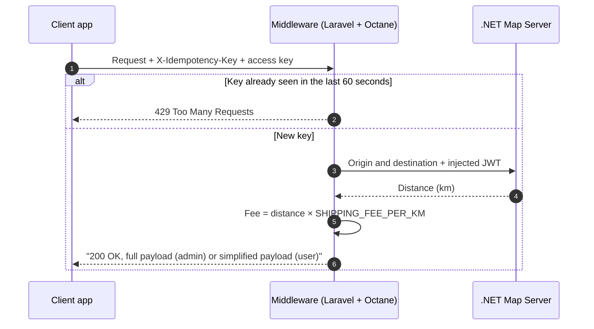

<p align="center">
  <a href="https://laravel.com" target="_blank">
    
  </a>
</p>

<h1 align="center">Food Delivery Middleware API</h1>

<p align="center">
  A secure middleware between a food-delivery client and a .NET Map Server.<br>
  Calculates shipping fees from real distance, guards against duplicate requests, and shapes responses by role.
</p>

<p align="center">
  
  
  
  
</p>

<p align="center">
  <a href="#-features">Features</a> ·
  <a href="#-how-it-works">How it works</a> ·
  <a href="#-getting-started">Getting started</a> ·
  <a href="#-testing-the-api">Testing</a> ·
  <a href="#-status-codes">Status codes</a>
</p>

---

## 📖 About

The food-delivery client never talks to the Map Server directly. This middleware sits in between: it forwards origin and destination coordinates, turns the returned distance (km) into a shipping fee, and protects the upstream server with a duplicate-request guard, JWT authentication, and a role-based response gate.

## ✨ Features

|     | Feature                     | What it does                                                                                                                                                                                                                                |
| --- | --------------------------- | ------------------------------------------------------------------------------------------------------------------------------------------------------------------------------------------------------------------------------------------- |
| 🧭  | **Routing & proxy**         | Forwards origin and destination coordinates to the Map Server.                                                                                                                                                                              |
| 💰  | **Dynamic pricing engine**  | Computes the shipping fee from the exact distance (km) returned by the Map Server, using `SHIPPING_FEE_PER_KM`.                                                                                                                             |
| 🛡️  | **Duplicate-request guard** | Each request carries an `X-Idempotency-Key` header. The key is cached for 60 seconds; repeating it inside that window returns `429 Too Many Requests` instead of being processed again. After the window expires the key is treated as new. |
| 🔑  | **JWT authentication**      | Injects a JSON Web Token into the HTTP client's request header to authenticate with the central server.                                                                                                                                     |
| 🚪  | **Role-based data gate**    | Admin requests receive the full data array. User requests receive a simplified payload formatted through `PrivateKeyScheme`.                                                                                                                |

## 🏗 How it works


## 🧰 Tech stack

| Layer         | Technology                                        |
| ------------- | ------------------------------------------------- |
| Framework     | Laravel                                           |
| Language      | PHP 8.2+                                          |
| Server engine | Laravel Octane (FrankenPHP / Swoole / RoadRunner) |
| Cache driver  | File or Redis                                     |
| HTTP client   | Laravel HTTP Facade                               |
| API testing   | Postman                                           |

## 🚀 Getting started

### 1. Install

1. Clone this repository.
2. Install dependencies:

    ```bash
    composer install
    ```

3. Copy the environment file:

    ```bash
    cp .env.example .env
    ```

4. Generate the application key:

    ```bash
    php artisan key:generate
    ```

### 2. Configure

The duplicate-request guard relies on the cache, and the pricing engine reads its values from `.env`. Set these in your `.env` file:

```env
# Use 'file' to test without setting up an additional database or Redis
CACHE_STORE=file

# Shipping calculation (adjust for production)
SHIPPING_FEE_PER_KM=0.56
MAP_SERVER_URL=https://your-map-server.example.com/v1/distance
MAP_SERVER_JWT=your-jwt-here

# Access gate keys (generate your own: php -r "echo base64_encode(random_bytes(16));")
SHIPPING_KEY_ADMIN=change-me
SHIPPING_KEY_USER=change-me
```

> [!IMPORTANT]
> After every change to `.env` (for example, switching the Map Server URL from local to production), clear the configuration cache so Laravel reads the new values:
>
> ```bash
> php artisan config:clear
> ```

> [!WARNING]
> Never commit real keys or tokens. Keep them in your local `.env`, which is git-ignored.

### 3. Run

This project is configured for Laravel Octane. Start the server with:

```bash
php artisan octane:start --watch
```

> [!NOTE]
> Octane needs a supported server runtime such as FrankenPHP or RoadRunner installed on your system.

## 🧪 Testing the API

Use **Postman** to try the endpoints and inspect request and response specifications.

1. Open Postman.
2. Import `Food Delivery Middleware.postman_collection.json` from the root of this repository.
3. All headers (including `X-Idempotency-Key`), coordinate bodies, and target URLs are pre-configured in the collection.

### Troubleshooting

| Symptom                   | Likely cause                                                         | Fix                                                                                                             |
| ------------------------- | -------------------------------------------------------------------- | --------------------------------------------------------------------------------------------------------------- |
| `429 Too Many Requests`   | The duplicate-request guard is active for this key.                  | Wait 60 seconds, send a new `X-Idempotency-Key`, or run `php artisan cache:clear`.                              |
| `503 Service Unavailable` | The Map Server is unreachable, or the URL or JWT in `.env` is wrong. | Check `MAP_SERVER_URL` and `MAP_SERVER_JWT`, confirm the server is online, then run `php artisan config:clear`. |
| New `.env` values ignored | Cached configuration.                                                | Run `php artisan config:clear`.                                                                                 |

## 🚦 Status codes

| Code  | Meaning                                                   |
| ----- | --------------------------------------------------------- |
| `200` | Fee calculated. The payload depends on the caller's role. |
| `429` | Duplicate request inside the 60-second window.            |
| `503` | The Map Server is unreachable or misconfigured.           |

## 📌 Project status

Built as a freelance prototype and kept here as a portfolio project. Not deployed.

---

<p align="center">
  Built by <a href="https://github.com/YoriSyahputra"><b>Yori Syahputra Wisnu</b></a> ·
  <a href="https://www.linkedin.com/in/yorisyahputrawisnu">LinkedIn</a>
</p>

<!--
TODO before publishing (delete this block afterwards):

1. Add a request/response example. Fill from a real Postman run, then move it
   under "How it works":

   ## 📨 Example

   **Request** `POST <your endpoint>`
   Headers: `X-Idempotency-Key: <uuid>`, `<your access key header>: <key>`

   ```json
   <paste request body from Postman>
   ```

   **Response, admin role (full payload)**
   ```json
   <paste response>
   ```

   **Response, user role (simplified via PrivateKeyScheme)**
   ```json
   <paste response>
   ```

2. Add a "Testing" section only if `php artisan test` passes:

   ```bash
   php artisan test
   ```

3. Add the exact Laravel version from composer.json to the Tech stack table.
-->
